# PHP-WebSec-VectorLab

[](https://www.php.net/)
[](#what-i-built)
[](#what-i-built)

> **Back when I was pentesting,** I wanted a compact place to reproduce the bugs that matter, understand exactly why they happen, and practice the fixes—not just collect screenshots of alerts. I built that idea into a modular, battle-tested, vulnerable-by-design lab: six realistic application security scenarios, an observable local stack, and secure patterns beside the deliberately unsafe ones.

I built PHP-WebSec-VectorLab for practitioners who want to move fluently from request tampering to root cause, then from exploit evidence to a defensible code change. The vulnerabilities are intentional. I keep every test inside my own local sandbox—not on the internet.

> [!WARNING]
> I designed this application to be vulnerable. I run it only on a machine and network I control, bind the server to loopback, and never expose it to a public interface or upload real files or data. I use only intentionally fake lab accounts and records.

## What I built

I wired six hands-on modules into a PHP 8.4.27 application served by PHP's built-in development server, with SQLite through PDO and a lightweight HTML/CSS interface. I use Burp Suite Pro for request inspection, Netcat for local SSRF telemetry, and sqlmap for bounded, local verification. Kali Linux is a convenient testing workstation; the app itself needs PHP with PDO SQLite.

### System architecture

I keep the application intentionally small so the request path stays visible: my browser or intercepting proxy talks to the local PHP server, PHP routes into one of six modules, and PDO reads or writes the local SQLite database.

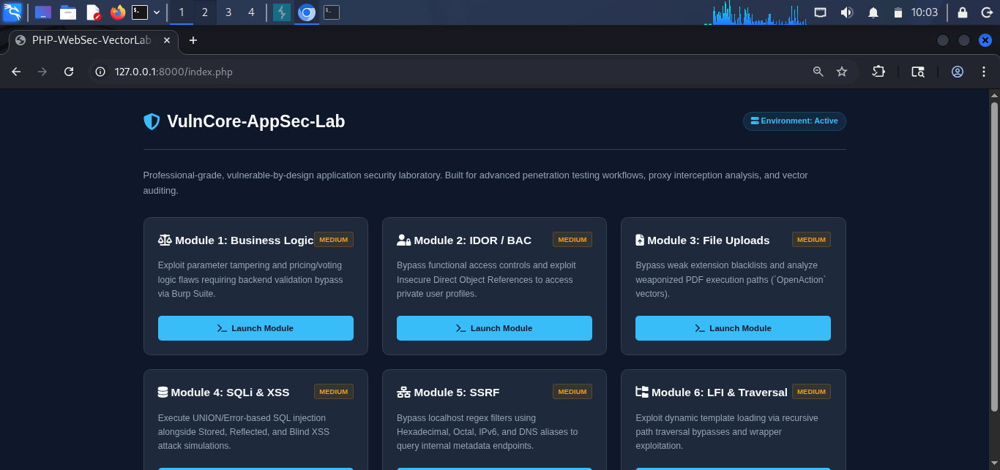

| Layer | What I run |
| --- | --- |
| Browser / proxy | Browser with Burp Suite Pro configured to intercept local lab traffic |
| Web application | PHP 8.4.27 CLI built-in server (`php -S`), HTML, and vanilla CSS |
| Data | SQLite database managed through PHP PDO and initialized with lab records |
| Supporting tools | Netcat for a local listener; sqlmap for controlled SQLi verification; Kali Linux for the testing environment |

## Start the lab

For a fresh installation, clone the repository using its GitHub URL. From the repository root, enter the inner `PHP-WebSec-VectorLab` application directory before starting the server. If the repository is already checked out, skip the clone command and start at the directory-change command.

### Windows PowerShell

```powershell
git clone <repository-url> PHP-WebSec-VectorLab
Set-Location .\PHP-WebSec-VectorLab\PHP-WebSec-VectorLab
php -v
php -m
php -S 127.0.0.1:8000
```

### Kali Linux / Bash

```bash
git clone <repository-url> PHP-WebSec-VectorLab
cd PHP-WebSec-VectorLab/PHP-WebSec-VectorLab
php -v
php -m
php -S 127.0.0.1:8000
```

I use PHP 8.4.27 and verify that `PDO` and `pdo_sqlite` are enabled in `php -m`. On the first request, the app creates and seeds its SQLite database. I open `http://127.0.0.1:8000/` to reach the dashboard and stop the server with **Ctrl+C**.

## Reconnaissance

When I begin a web assessment, I first establish the target's exposed surface and technology fingerprint before exercising individual application workflows. For this lab, I keep reconnaissance scoped to my local target at `127.0.0.1:8000`; WhatWeb fingerprints the HTTP-facing stack, and Nmap checks the local service and HTTP behavior.

```bash
whatweb -v http://127.0.0.1:8000
nmap -p 8000 -sV --script "http-enum,http-methods,http-headers" 127.0.0.1
```

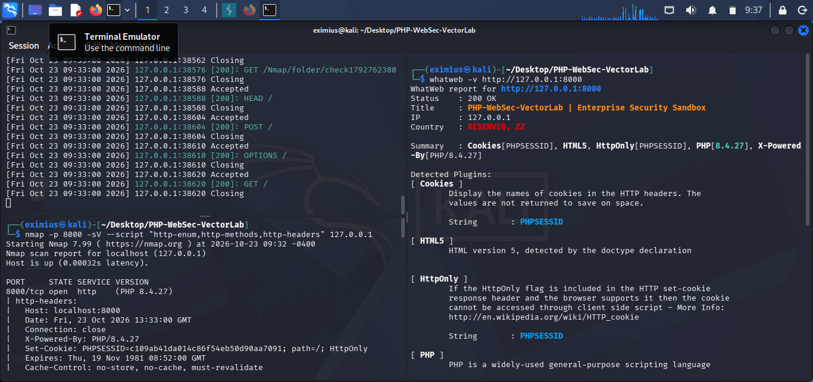

### Local testing tools

I configure Burp to proxy my browser's traffic to the local app at `127.0.0.1:8000`. If the browser bypasses proxies for loopback addresses, I adjust its proxy exclusions for this local test only.

For the SSRF exercise, I start a listener in a second Kali terminal on the same machine as the PHP server:

```bash
nc -lvnp 9090
```

For automated SQLi verification, I target only the local module:

```bash
sqlmap -u "http://127.0.0.1:8000/modules/module4_sqli_xss.php?search=test" \
  -p search --level=2 --risk=1 --batch --dbms=SQLite
```

I treat automated tooling as corroboration for my manual observation—not permission to scan other systems.

## The six modules

### Module 1 — Business Logic Flaws & Parameter Tampering

**The story.** What happens when the browser gets to decide how much a product costs? In my checkout simulation, hidden form fields look authoritative—but every client-controlled field can be edited before the server sees it.

**What fails.** The checkout handler trusts the submitted `price` and multiplies it by the submitted `quantity`. It does look up the product name, but never reloads the authoritative price or validates stock before calculating the total. The poll handler also accepts a client-supplied `vote_id`, allowing a caller to choose which existing poll receives the vote.

**Local PoC.** I submit a normal checkout, intercept it in Burp, and change `price` to `0.01`; the app's success threshold makes the tampering visible. I can also change `vote_id` to another seeded poll ID and observe which count increments. I keep these requests on `127.0.0.1`.

```http
POST /modules/module1_logic.php HTTP/1.1
Host: 127.0.0.1:8000
Content-Type: application/x-www-form-urlencoded

action=checkout&product_id=1&quantity=1&price=0.01
```

**How I fix it.** I accept only the product identifier and a validated quantity, then calculate the price from the database. I also validate stock and authorize the requested business action on the server.

```php
$productId = filter_input(INPUT_POST, 'product_id', FILTER_VALIDATE_INT);
$quantity = filter_input(INPUT_POST, 'quantity', FILTER_VALIDATE_INT);

if (!$productId || !$quantity || $quantity < 1) {
    http_response_code(400);
    exit('Invalid order.');
}

$stmt = $pdo->prepare('SELECT price, stock FROM products WHERE id = :id');
$stmt->execute(['id' => $productId]);
$product = $stmt->fetch();

if (!$product || $quantity > (int) $product['stock']) {
    http_response_code(400);
    exit('Product unavailable.');
}

$total = (float) $product['price'] * $quantity;
```

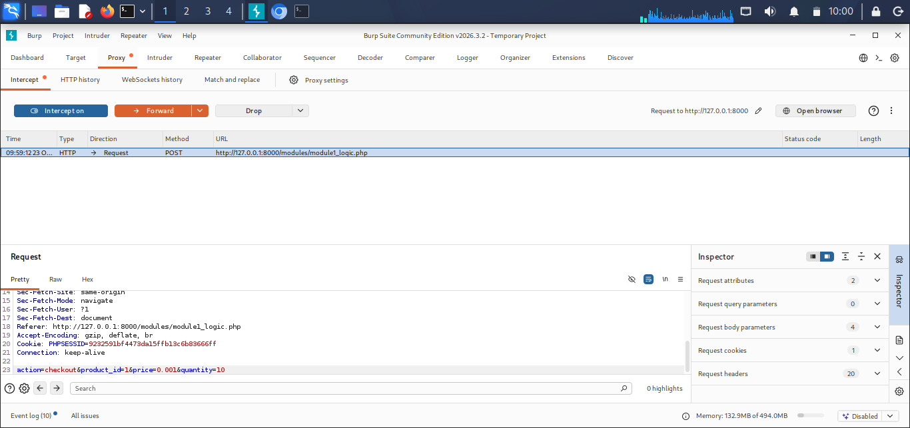
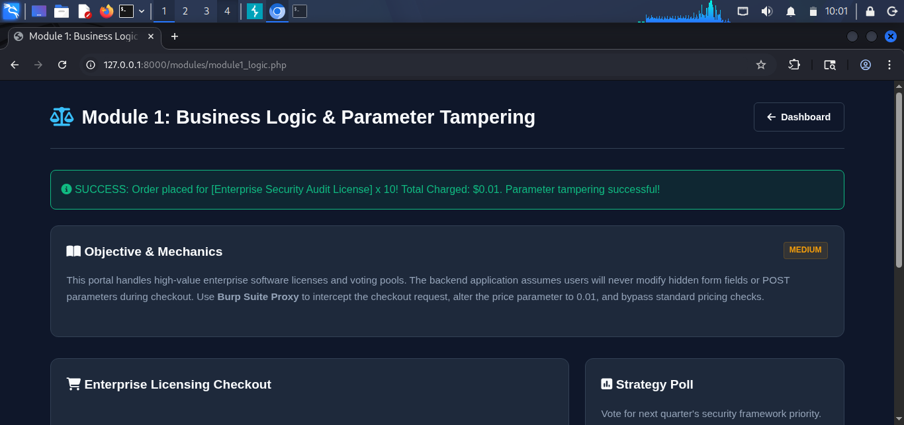

### Module 2 — Broken Access Control & IDOR

**The story.** Does being signed in mean I am allowed to see every profile? Here, it doesn't. A profile identifier is treated as both an address and an authorization decision.

**What fails.** The page accepts `user_id` from the URL to select a profile and from the POST body to update one. It never checks that the authenticated user owns the record or has an explicitly authorized administrative role. This enables horizontal access to another user's data and vertical access to the administrator's profile; the update endpoint also permits unauthorized changes. The profile is reachable even without a logged-in session.

**Local PoC.** I can sign in with the seeded standard account `john_doe` / `password123`, then change the URL from `?user_id=2` to `?user_id=1`. I can also intercept the profile update form and alter its `user_id`. The demonstration data includes fictional sensitive-looking fields, so I never use real personal information in this lab.

**How I fix it.** I require authentication, derive the acting user from the session, and authorize every read and write against the requested record. I do not trust a hidden form field to establish ownership.

```php
$viewerId = (int) ($_SESSION['user_id'] ?? 0);
$targetId = filter_input(INPUT_GET, 'user_id', FILTER_VALIDATE_INT);
$isAdmin = ($_SESSION['role'] ?? '') === 'administrator';

if ($viewerId === 0) {
    http_response_code(401);
    exit('Authentication required.');
}

if (!$targetId || ($targetId !== $viewerId && !$isAdmin)) {
    http_response_code(403);
    exit('Not authorized.');
}

$stmt = $pdo->prepare(
    'SELECT id, username, email, notes FROM users WHERE id = :id'
);
$stmt->execute(['id' => $targetId]);
```

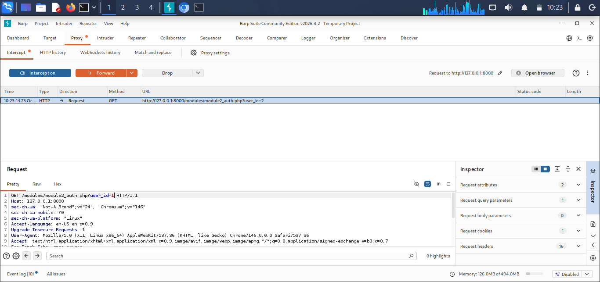
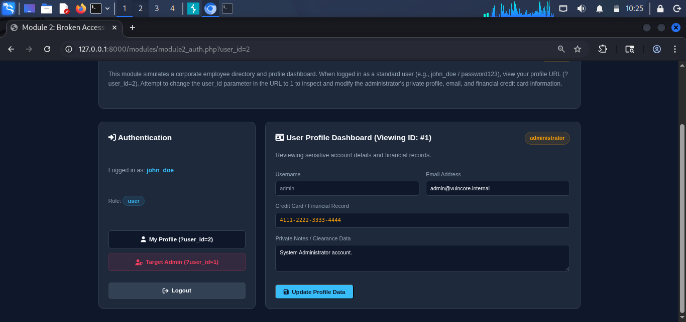

### Module 3 — Unrestricted File Uploads & Stored XSS

**The story.** A document portal is not just a document portal if uploaded content lands in a public, executable directory. I use this module to examine what a weak extension blacklist actually allows.

**What fails.** The upload handler stores user-named files beneath the web root and checks a denylist containing `php3`, `php4`, and `pht`. Crucially, the lab intentionally omits `.php` from that blacklist, so a `.php` file is accepted; the lab's captured execution proof demonstrates the risk in its local PHP server setup. An extension denylist is not a file-type control, and a public upload directory is not a safe execution boundary.

I also connect the upload threat model to the stored-XSS review queue: a malicious document can be a delivery or staging artifact, while the unescaped feedback-rendering sink is implemented in Module 4. A PDF `/OpenAction` is a client-side PDF-reader behavior, not PHP server-side execution; I only inspect harmless, controlled samples in an isolated lab viewer.

**Local PoC.** I upload a harmless PHP proof-of-execution file to the local portal and observe how the server handles it. I do not use command-execution web shells or stage payloads on systems outside this sandbox. For the related stored-XSS path, I submit the benign obfuscation-case test `` to the Module 4 feedback queue and observe the browser event in the lab.

**How I fix it.** I use an allowlist, inspect the detected MIME type, generate a server-side filename, store uploads outside the web root, and serve them through a handler that sets safe content headers. I disable script execution in any upload-serving location.

```php
$allowed = ['pdf' => 'application/pdf', 'png' => 'image/png', 'jpg' => 'image/jpeg'];
$extension = strtolower(pathinfo($_FILES['document']['name'], PATHINFO_EXTENSION));
$finfo = new finfo(FILEINFO_MIME_TYPE);
$mime = $finfo->file($_FILES['document']['tmp_name']);

if (!isset($allowed[$extension]) || $allowed[$extension] !== $mime) {
    http_response_code(400);
    exit('Unsupported file.');
}

$storedName = bin2hex(random_bytes(16)) . '.' . $extension;
$destination = '/srv/app-private-uploads/' . $storedName;

if (!move_uploaded_file($_FILES['document']['tmp_name'], $destination)) {
    throw new RuntimeException('Upload storage failed.');
}
```

For the feedback queue, I encode the value at the HTML output boundary:

```php
echo htmlspecialchars($comment, ENT_QUOTES | ENT_SUBSTITUTE, 'UTF-8');
```

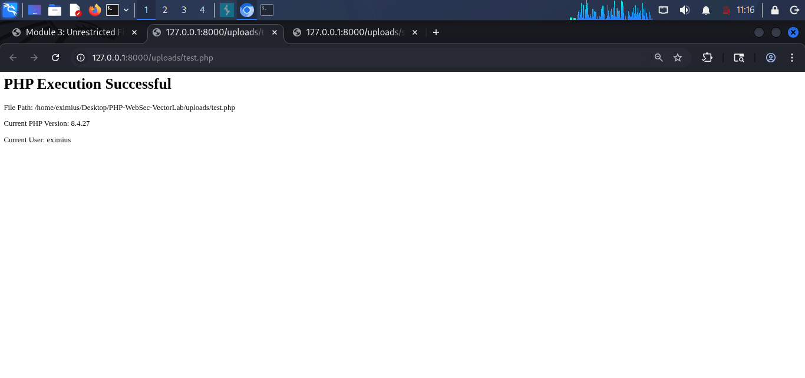

### Module 4 — SQL Injection & Stored XSS

**The story.** Search should find products—not rewrite the query. I put both a vulnerable catalog search and a stored-feedback rendering sink in this module so I can trace input from request to database to browser.

**What fails.** The catalog search concatenates the `search` parameter into a SQL `LIKE` expression. A single quote (`'`) breaks the intended string and produces a visible SQLite error banner. A boolean tautology such as `' OR 1=1 -- ` changes the query logic; a compatible four-column `UNION SELECT` can make database values appear in catalog rows. Separately, feedback is inserted with a prepared statement but rendered raw in the review queue: parameterized storage does not prevent stored XSS at the output boundary.

**Local PoC.** I start with a quote to observe the SQL error, then try a tautology and a controlled union in the `search` field:

```text
'
' OR 1=1 -- 
' UNION SELECT id, username || ':' || role, 0, 0 FROM users -- 
```

I can have sqlmap verify the local `search` parameter with the bounded command in [Local testing tools](#local-testing-tools). For the stored-XSS proof, I submit a benign `alert()`-only event-handler test such as `` in the feedback form. The lab's image shows the browser dialog; I never use cookie theft or external callbacks.

**How I fix it.** I use parameterized SQL for values and encode untrusted text for the exact output context. I keep detailed database errors in server logs rather than returning them to users.

```php
$stmt = $pdo->prepare(
    'SELECT id, name, price, stock FROM products WHERE name LIKE :search'
);
$stmt->execute(['search' => '%' . $search . '%']);
$products = $stmt->fetchAll();
```

```php
echo htmlspecialchars($feedback['comment'], ENT_QUOTES | ENT_SUBSTITUTE, 'UTF-8');
```

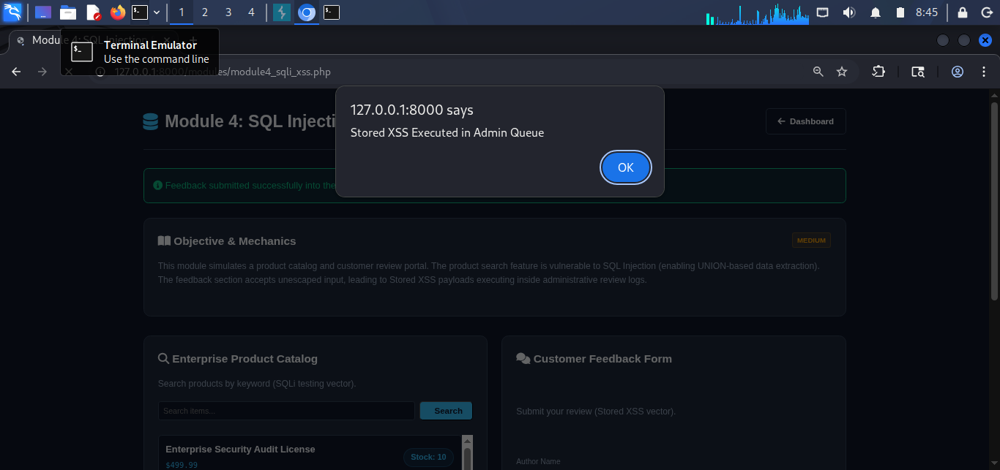
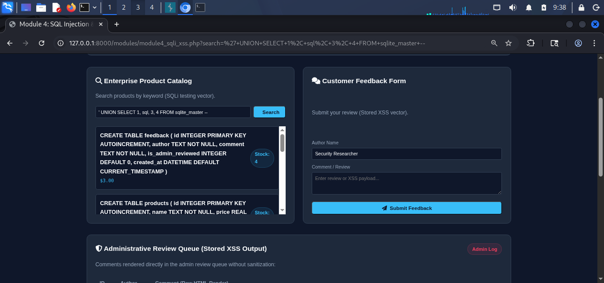
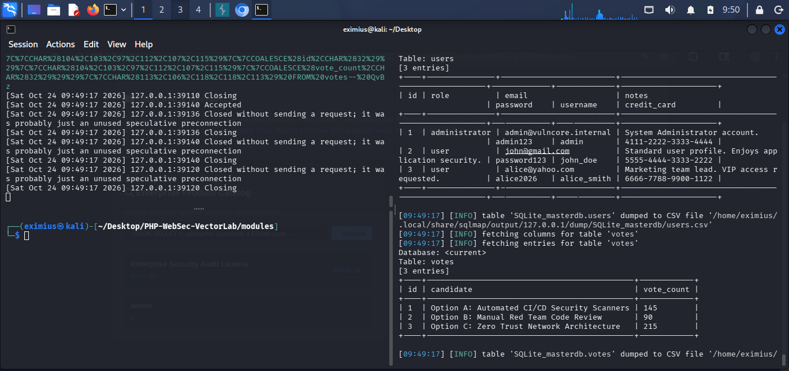

### Module 5 — Server-Side Request Forgery (SSRF)

**The story.** A server-side “health check” can become a confused deputy when it fetches a URL chosen by a visitor. A text filter is not a network security boundary.

**What fails.** The fetcher accepts a user-supplied URL and blocks only literal `127.0.0.1` and `localhost` strings. Alternative IP notation can evade that check. The server performs the outbound request and attaches `User-Agent: VulnCore-HealthChecker/2.0`, making a local request observable in a listener.

**Local PoC.** With my Netcat listener running on the same machine as the lab, I submit `http://0x7f000001:9090/` to the local SSRF form. The listener should show a request carrying `User-Agent: VulnCore-HealthChecker/2.0`. This test is deliberately limited to my own loopback listener; I do not use the fetcher to probe cloud metadata, private networks, or third-party hosts.

**How I fix it.** I avoid arbitrary URL fetching where possible. If the product requires it, I allow only known HTTPS destinations, resolve and validate every address, block loopback/private/link-local ranges, re-check after redirects, and enforce equivalent egress controls at the network layer.

```php
$parts = parse_url($url);
$allowedHosts = ['status.example.test'];

if (
    $parts === false ||
    ($parts['scheme'] ?? '') !== 'https' ||
    !in_array(strtolower($parts['host'] ?? ''), $allowedHosts, true)
) {
    http_response_code(400);
    exit('Destination not allowed.');
}
```

I treat that allowlist as only one layer: a production fetcher must also defend against DNS rebinding, redirects to disallowed addresses, and unsafe resolved IP ranges.

### Module 6 — Local File Inclusion & Path Traversal

**The story.** A template selector looks harmless until a URL parameter becomes a filesystem path. I use this module to show why a one-pass string replacement is not path validation.

**What fails.** The loader removes the literal `../` once using `str_replace()` and then concatenates the result to a template directory without checking the final resolved path against an allowlist. A recursive-collapse input such as `....//config.php` survives the one-pass filter as a parent-directory traversal after path normalization.

**Local PoC.** I request the local module with `?page=....//config.php` to demonstrate traversal from the templates directory into the application directory. Including a PHP configuration file may execute it rather than display its source. PHP's `php://filter/convert.base64-encode/resource=...` wrapper is a useful LFI concept, but this implementation prepends the template-directory path before the supplied value; that means a wrapper URI is not directly recognized by this exact sink. I call out that limitation rather than claiming a wrapper PoC that the current path construction does not support.

For a separate, explicitly controlled include sink, the wrapper form I test is:

```text
php://filter/convert.base64-encode/resource=/absolute/path/to/config.php
```

I do not present that URI as a working payload against this module without first changing its path construction.

**How I fix it.** I map a small set of public keys to known templates and never derive an include path directly from request data.

```php
$templates = [
    'home' => __DIR__ . '/../templates/home.php',
    'about' => __DIR__ . '/../templates/about.php',
];

$page = $_GET['page'] ?? 'home';

if (!is_string($page) || !isset($templates[$page])) {
    http_response_code(404);
    exit('Template not found.');
}

require $templates[$page];
```

If a use case truly requires path-based access, I canonicalize the resolved path with `realpath()` and enforce that it remains inside a fixed, trusted directory before opening it.

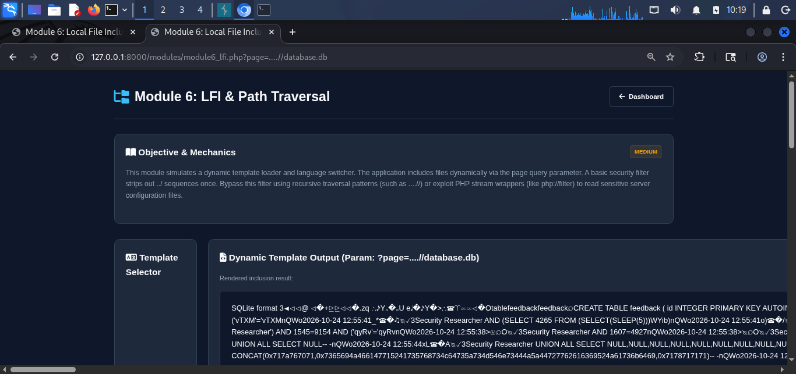

## What I take away

I built this lab to connect the attacker-visible behavior to the code-level root cause—and then to a fix I can explain and defend in review. Across the six modules, I demonstrate:

- **Defensive engineering:** I replace trust in client input with server-side validation, authorization, safe storage, and output encoding.
- **Offense-to-defense correlation:** I trace each controlled PoC to its vulnerable sink and the corresponding mitigation.
- **Vulnerability research:** I investigate how weak filters, alternate encodings, and request parsing behave in a constrained test environment.
- **Root-cause analysis:** I identify why the bug exists, not just which scanner finding describes it.
- **Secure code review:** I recognize unsafe SQL construction, missing object-level authorization, executable upload paths, unescaped output, arbitrary outbound requests, and dynamic file inclusion.

## Responsible use

I use PHP-WebSec-VectorLab only for local education, controlled testing, and defensive engineering practice. I do not expose the built-in PHP server to a public or shared network, and I do not use the examples against systems without explicit authorization. The PHP built-in server is for development and lab use—not production deployment.
